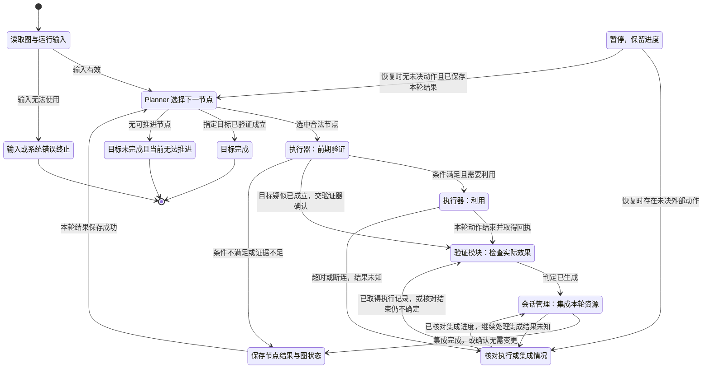

# 攻击图自动验证系统：项目级状态机草稿

> 版本：V0.1｜日期：2026-10-10｜状态：供用户修改的设计草稿
>
> 本文依据本次讨论起草目标流程，尚未作为实现契约定稿；不代表现有代码已经具备文中能力。状态名、字段名是设计用名，定稿时再与实际接口对应。

## 1. 先看主流程

**输入图数据 → Planner 选择下一验证节点 → 执行器前期验证 → 执行器利用 → 验证模块 → 会话管理集成 → 保存本轮结果 → 回到 Planner。**

每轮验证一个节点。Planner 根据上一轮结果和最新会话状态，决定下一步验证哪个节点，直到目标完成或当前任务无法继续。

这里区分两个概念：

- **模块**：谁负责做事，例如 Planner、执行器、验证器、会话管理器。
- **状态**：当前任务走到哪一步，例如正在规划、正在利用、正在验证。

编排器负责调用模块、接收结果、推进状态和保存进度。它是程序中的流程控制者，暂不增加一个负责自由决策的“编排 Agent”。

### 本稿范围

- 输入已经生成的攻击图，结合主机映射、初始访问条件和已有会话执行验证。
- 本稿描述项目主循环，以及一个节点从选中到结果提交的过程。
- 本稿不定义具体漏洞利用命令，不改技能卡格式，不绑定某个模型或开发框架。
- 图、主机地址、服务信息、技能标识与节点标识均来自输入或配置，不写死在流程规则中。

### 草稿暂定规则

| 项目 | 本稿暂定 | 用户修改 |
|---|---|---|
| 调度粒度 | Planner 每轮给出一个下一节点；允许附带候选节点及理由 | |
| 执行顺序 | 先串行跑通完整流程；多 Agent 表示职责分工，不默认并行执行 | |
| 完成条件 | 本次指定验证目标全部成立；是否要求覆盖整张图，见第 12 节 | |
| 前期验证的职责 | 确认能否执行，并确认目标是否已经成立 | |
| 成功判定的职责 | 验证模块给出成立、不成立或证据不足的结论 | |
| 会话集成时机 | 验证完成后正式集成；验证前可以使用本轮临时会话引用 | |
| 重试位置 | 由编排器回到 Planner 后决定，不在执行底层无记录重放 | |

## 2. 项目状态图

图中展示正常流程和主要异常分支。暂停、恢复与不可恢复错误的通用规则见第 7 节，不在图中给每个状态重复画线。

`RECONCILING` 必须记录是在核对“利用执行”还是“会话集成”，据此返回对应阶段，不能任意选择下一阶段。

## 3. 系统输入与最终输出

### 3.1 输入

| 输入 | 内容 | 用途 |
|---|---|---|
| 攻击图 | 节点、依赖关系、前置事实、目标事实、AND/OR 语义 | 确定要验证什么及其依赖 |
| 资产与主机映射 | 图中实体对应的实际主机、端点和部署信息 | 把图节点绑定到实际目标 |
| 初始条件 | 起始访问位置、已有权限、凭据引用、已有会话 | 建立可执行的初始状态 |
| 本次目标 | 目标节点或目标事实 | 决定何时完成 |
| 运行限制 | 时间、调用或重试预算等 | 避免无进展的无限循环 |
| 技能与工具目录 | 可用方法、参数及调用入口 | 支撑执行器选择和执行方法 |

输入图中“推导成立”的事实与运行时“已经验证”的事实分开记录。只有被本次规则接受的初始事实或有效执行证据，才能作为对应前置条件的依据。

### 3.2 输出

- 本次运行结论：目标完成、无法推进、暂停或系统错误。
- 节点验证记录：成立、不成立、证据不足或前置条件阻塞，以及原因。
- 路径记录：实际选择与验证的节点顺序、跳过原因、重规划原因。
- 证据索引：每次调用的原始输出、判定依据与引用关系。
- 会话清单：已有、新增、更新、不可用及需要后续处理的资源。

## 4. 各模块具体做什么

| 模块 | 主要输入 | 本轮工作 | 主要输出 |
|---|---|---|---|
| 输入处理 | 图、映射、初始条件、目标 | 检查引用关系、目标与实体映射；保留原图语义 | 可读取的图与初始运行上下文 |
| Planner | 图、已提交节点结论、失败原因、可用会话 | 选择下一节点，说明选择理由、所需前提与验证目标 | 下一节点、完成或无法推进 |
| 执行器前期验证 | 当前节点、技能前提、已有会话与参数 | 检查条件、资源和执行位置；判断是否需要利用 | 可执行、目标可能已成立、阻塞或证据不足 |
| 执行器利用 | 当前节点、前期验证结果、选中方法 | 准备并执行本轮动作；记录调用与实际产物 | 执行回执、原始输出、临时会话和资源引用 |
| 验证模块 | 目标事实、原始输出、必要会话引用 | 检查利用后的实际效果；必要时补充验证观察 | 成立、不成立或证据不足，以及依据 |
| 会话管理 | 验证结论、本轮资源、已有会话清单 | 识别、检查、登记或更新资源；处理无效及残留资源 | 集成结果、可用性与资源引用 |
| 编排器 | 各模块结果与当前状态 | 检查结果归属，执行迁移，提交进度，决定是否继续 | 下一状态与完整运行记录 |

### 4.1 Planner

Planner 每轮读取最新的已提交状态，输出以下三种结果之一：

1. **选择节点**：节点标识、选择理由、需要的前提、验证目标、拟使用的已有会话引用。
2. **目标完成**：引用已提交的目标证据，由编排器确认后结束。
3. **无法推进**：列出尚未满足的依赖、缺失资源或已耗尽的可行方案。

Planner 给出的是选择建议。编排器仍需核对节点是否属于输入图、依赖是否合法、所引用资源是否存在。

前置条件未变化时，不应反复选择刚被同一原因阻塞的节点；已有有效验证结论的节点，也不应无理由重复执行。

### 4.2 执行器：前期验证

前期验证回答“现在能不能做”，利用后验证回答“做完有没有达到目标”。

前期验证包括：

- 检查依赖事实及其依据是否足以支持本次执行。
- 核对目标、执行位置、会话身份与必要权限。
- 检查技能要求的参数与资源是否齐全。
- 进行必要的观察，判断环境是否符合利用条件。

结果为“可执行”才进入利用；若观察到目标可能已经成立，直接交验证模块确认，避免重复改变目标环境。

前期验证暂定只做观察与准备，不执行利用动作。若某项准备会修改环境，应单独记录为明确动作，其边界在第 12 节修改。

### 4.3 执行器：利用

- 在已经确认的目标和执行位置上，选择并执行适用方法。
- 每个实际工具调用独立记录；一个节点尝试可以包含多个相关调用。
- 记录执行开始、结束、错误、产物及本轮产生的临时资源。
- 工具返回非零退出码时仍保存原始结果，交验证模块判断实际效果。
- 若结果未知，进入核对流程；底层不因为超时自动重放修改类动作。

执行器报告“做了什么、看到了什么”，节点的最终验证结论由验证模块给出。

### 4.4 验证模块

- 确认证据对应当前目标、当前节点与当前尝试。
- 根据节点目标检查实际效果，而非只检查工具是否正常退出。
- 必要时，通过既有会话或本轮临时会话进行补充观察。
- 输出 `pass`、`unsatisfied` 或 `uncertain`，同时给出证据引用和解释。

验证模块可以使用规则、模型或二者结合。本稿不要求增加新的重型证据格式，也不预设只能由模型或只能由程序完成判断。

### 4.5 会话管理集成

保持用户指定的顺序：**验证结束后，进入正式会话集成。**

为避免“必须先登记会话才能验证，但必须先验证才能登记”的循环，暂定：

1. 利用阶段产生的会话先作为**本轮临时引用**保存，可供当前验证使用。
2. 验证后，会话管理模块检查会话身份、目标、权限、有效性及来源。
3. 检查符合可复用要求的资源，正式登记或更新为后续节点可引用的资源。
4. 未通过检查或来源不明的资源，记录为不可用或待核对，并保留后续处理信息。
5. 本轮没有产生会话时，明确返回“无变更”，正常进入结果提交。

验证失败也可能留下实际资源，因此“验证不成立”或“证据不足”同样进入会话集成，由会话管理记录和处置这些资源。

**节点验证结论与会话可用性分别保存。** 节点成立不保证会话始终存活；会话存在也不证明节点目标已经达成。Planner 选择后继节点时，同时检查事实依赖与所需资源是否可用。

### 4.6 结果提交

本轮结束时，编排器保存节点结论、证据引用、会话集成结果与下一轮需要的上下文，提交成功后再回到 Planner。

会话集成或本地保存出错时，保留已取得的验证结果，恢复后继续未完成的集成或提交，不能重新执行已完成的利用来“补齐流程”。

## 5. 状态定义

本表描述**一次运行当前所处的阶段**。节点结论与会话状态另行记录，不与主流程状态混用。

| 状态 | 含义 | 负责模块 |
|---|---|---|
| LOADING | 正在读取并检查图与运行输入 | 输入处理 |
| PLANNING | 正在选择下一节点或决定结束 | Planner |
| PRECHECKING | 正在检查当前节点的执行前提 | 执行器 |
| EXPLOITING | 正在执行当前节点的利用动作 | 执行器 |
| VERIFYING | 正在检查节点目标是否实际成立 | 验证模块 |
| SESSION_SYNC | 正在集成本轮产生或变化的资源 | 会话管理 |
| COMMITTING | 正在保存本轮结果，准备下一轮规划 | 编排器 |
| RECONCILING | 存在未决动作，正在核对执行或集成情况 | 编排器及对应模块 |
| PAUSED | 当前运行暂停，保留恢复位置和原因 | 编排器 |
| SUCCEEDED | 指定目标已有足够验证依据 | 终态 |
| BLOCKED | 目标未完成，现有依赖和资源下无法推进 | 终态，可在新输入下新建运行 |
| FAILED | 输入无效或不可恢复的系统错误导致终止 | 终态 |

`unsatisfied` 是某次节点验证未成立，不等于整次运行 `FAILED`。其他路径仍可继续时，应返回 Planner。

## 6. 核心状态迁移表

同一事件涉及多种结果时，结果条件必须互斥；事件要带本次运行、节点和尝试的归属信息。

| 编号 | 当前状态 | 事件与条件 | 必要动作 | 下一状态 |
|---|---|---|---|---|
| T01 | LOADING | 输入检查通过 | 保存图与初始上下文 | PLANNING |
| T02 | LOADING | 输入无法使用 | 记录具体输入错误 | FAILED |
| T03 | PLANNING | 返回合法下一节点 | 建立本次节点尝试及输入快照 | PRECHECKING |
| T04 | PLANNING | 目标已经满足且证据可引用 | 保存本轮总结 | SUCCEEDED |
| T05 | PLANNING | 目标未完成且没有可推进节点 | 保存阻塞依赖与缺失资源 | BLOCKED |
| T06 | PRECHECKING | 条件满足，仍需利用 | 保存检查依据与执行参数 | EXPLOITING |
| T07 | PRECHECKING | 已观察到目标可能成立 | 保存观察证据，标明未执行利用 | VERIFYING |
| T08 | PRECHECKING | 条件不满足或无法确认 | 保存阻塞或不确定原因，不发起利用 | COMMITTING |
| T09 | EXPLOITING | 当前调用序列结束且取得执行记录 | 保存原始输出和临时资源引用 | VERIFYING |
| T10 | EXPLOITING | 超时、断连或恢复后结果未知 | 保存未决调用，标明核对来源为利用 | RECONCILING |
| T11 | RECONCILING | 利用核对结束 | 交付已知记录；仍未知时明确标注 | VERIFYING |
| T12 | VERIFYING | 已生成三种验证结论之一 | 保存判定、理由和证据引用 | SESSION_SYNC |
| T13 | SESSION_SYNC | 资源已集成，或确认无变更 | 保存集成记录 | COMMITTING |
| T14 | SESSION_SYNC | 集成是否完成尚不明确 | 保存操作标识，标明核对来源为集成 | RECONCILING |
| T15 | RECONCILING | 会话集成进度已核对 | 复用已完成操作，只处理剩余工作 | SESSION_SYNC |
| T16 | COMMITTING | 结果保存成功 | 更新 Planner 可见状态 | PLANNING |

补充约束：

- Planner 返回不存在的节点或非法资源引用时，不进入前期验证；记录原因，在规划预算内重新规划，耗尽后暂停。
- T08 默认不会产生新会话；若未来允许前期验证创建资源，应同步修改为先进入 SESSION_SYNC，不能漏记资源。
- T11 中仍未知的执行结果，不得被验证器无依据转换为成功；必要验证观察仍无法判定时输出 `uncertain`。
- T15 不重新发起利用。会话管理根据现有记录检查是否已登记，避免重复登记和重复创建资源。

## 7. 暂停、异常与恢复规则

| 情况 | 处理方式 |
|---|---|
| 用户暂停、预算耗尽或可恢复服务错误 | 保存当前阶段、当前尝试及未决调用，进入 PAUSED；暂停不表示远端动作已经停止 |
| 恢复时存在未决利用或集成操作 | 先进入 RECONCILING，根据来源决定后续阶段 |
| 恢复时当前轮结果已提交 | 回到 PLANNING，由最新状态决定下一节点 |
| 恢复时只有本地阶段尚未完成 | 恢复到保存的阶段；重入前检查该阶段动作是否已经完成，避免副作用重放 |
| 验证阶段报错 | 保留执行产物，暂停在验证阶段；恢复后继续验证，不重做利用 |
| 会话集成或结果保存报错 | 保留判定和资源引用，继续集成或保存；不自动重做利用 |
| 不可恢复的系统错误 | 进入 FAILED，输出最后状态、已有证据及未决资源清单 |
| 收到旧尝试、重复或不匹配的事件 | 不改变当前状态，保留事件及处理原因 |

具体时间、重试次数和模型调用预算在定稿时填写。核对同样需要预算；预算耗尽仍不能确定结果时暂停，不无限停留在核对循环中。

外部动作和本地状态保存不假设是同一个事务。恢复的依据应包含动作标识、执行回执和实际观察；记录一条“已发送”不能证明动作已完成。

## 8. 模块间传递的最小信息

以下是便于讨论的信息清单，不要求照此新增所有代码字段或数据库表。

| 信息组 | 至少包含 |
|---|---|
| 运行上下文 | 运行标识、图与映射引用、目标、初始条件、运行限制 |
| 调度结果 | 下一节点、选择理由、前置要求、验证目标、已有资源引用 |
| 当前尝试 | 节点标识、尝试标识、当前阶段、执行位置、输入材料引用 |
| 前期验证结果 | 可执行/已观察到目标/阻塞/不确定，以及依据 |
| 执行结果 | 每次调用标识、执行状态、原始产物引用、临时会话引用 |
| 验证结果 | 成立/不成立/证据不足、理由、证据引用 |
| 会话集成结果 | 无变更/新增/更新/不可用/待核对、会话引用、身份与可用性 |
| 恢复信息 | 暂停原因、恢复阶段、未决动作及已完成步骤 |

模型只接收当前模块需要的材料。原始凭据、全量日志和完整会话对象不必随每次模块交接反复传递，按实际需要使用引用。

## 9. 不能破坏的基本规则

1. 只有编排器推进主流程状态；模块返回结果，不直接任意修改全局状态。
2. Planner 不能创造输入图之外的攻击节点；图变更作为独立输入修订处理。
3. 前期验证未确认可以执行时，不进入利用。
4. 本次工具调用结束，不自动等于本次节点验证成立。
5. 未经本轮验证和会话检查的临时资源，不直接作为后续节点的可用会话发布。
6. 没有新会话的节点可以正常结束；会话集成返回“无变更”。
7. 同一尝试不能被重复派发；迟到事件不能覆盖后续尝试。
8. 节点验证结果保存后仍保留其证据与时点；会话后续失效单独更新，不改写历史事实。
9. 每次实机调用都有可追溯产物；本稿不填写虚构调用记录或成功数据。
10. 更换图、主机映射、服务名和技能目录时，主流程状态及迁移规则保持不变。

## 10. 两条走读示例

以下实体名称是说明用代号，不是机器默认值。

### 示例 A：本轮产生新会话

1. 输入一张图，节点乙依赖节点甲；当前尚无节点甲的完成证据。
2. Planner 选择节点甲，说明其目标与所需前提。
3. 执行器前期验证确认条件满足。
4. 执行器完成利用，保存输出及临时会话引用。
5. 验证模块通过原始输出与临时会话的必要观察，判定节点甲目标成立。
6. 会话管理核对临时会话的目标、身份和有效性，将其登记为可复用资源。
7. 编排器保存节点甲结论及会话引用，再次调用 Planner。
8. Planner 在依赖与会话都满足时选择节点乙。

### 示例 B：利用超时，之后确认成功但没有新会话

1. 前期验证通过，利用动作发起后等待超时。
2. 编排器进入 RECONCILING，不重复发起原利用动作。
3. 核对取得实际执行记录，交验证模块检查目标状态。
4. 验证模块确认目标成立，输出依据；本次动作未创建会话。
5. 会话管理返回“无变更”，编排器保存结果，回到 Planner。

## 11. 定稿后应覆盖的验收情形

本节是未来实现的验收清单，不表示已经运行或通过。

- [ ] 正常流程按“规划—前期验证—利用—验证—会话集成—提交”顺序闭环。
- [ ] 前期条件不满足时，没有利用调用产生，且 Planner 能看到阻塞原因。
- [ ] 目标原本已成立时，经过验证确认后跳过利用。
- [ ] 工具执行结束但目标未达成时，不发布成功结论。
- [ ] 验证前可使用本轮临时会话，后续任务不能提前使用未检查资源。
- [ ] 无新会话时，集成步骤正常返回“无变更”。
- [ ] 利用超时后先核对，实际已完成的动作不被重复执行。
- [ ] 验证或会话集成出错后恢复，不重放已完成利用。
- [ ] 同一事件重复到达或旧尝试结果迟到，不改变当前正确状态。
- [ ] 指定目标完成与“当前没有可选节点”得到不同的运行结论。
- [ ] 替换图与主机映射、重命名节点和服务后，仍能按同一套状态规则完成流程。

## 12. 留给用户修改的关键位置

| 待定项 | 当前草稿选择 | 你的修改 |
|---|---|---|
| Planner 一次给一个节点，还是一批节点？ | 一个节点；其他候选可作解释材料 | |
| 运行追求目标完成，还是整图所有节点覆盖？ | 指定目标完成即结束 | |
| 前期验证是否允许准备环境或创建临时资源？ | 默认观察；改变环境的准备需显式定义 | |
| 前期验证失败后，执行器本地修正还是回 Planner？ | 先保存原因，再回 Planner | |
| 验证失败后是否允许执行器直接换方法？ | 暂定回 Planner，由新尝试承接重试 | |
| 会话管理要接管哪些资源？ | 先定义会话与执行身份；隧道、代理、凭据是否纳入另行明确 | |
| 验证是否需要单独模型？ | 模块职责独立，模型实例是否独立暂不指定 | |
| 节点事实成立但会话不可用时怎么办？ | 保留事实结论；后续依赖会话的节点等待资源恢复或其他路径 | |
| 时间、调用与重试预算是多少？ | 尚未填入具体数值 | |
| 终止时如何处理远端临时资源？ | 输出资源清单；自动回收范围与保留策略待定 | |

建议先修改本节中你有明确想法的选择，再同步修改第 2 节状态图与第 6 节迁移表。定稿后，再据此拆实现任务。

## Batch 3: saved boundaries and same-run recovery

The planner / step / done graph and 2*N+3 limit remain.
Each attempt saves its frozen parent source and channel/session/UUID references.
Recovery checks the same position; only a new attempt resolves again.
Use --resume with the original run-root and existing orchestrator lock.
Finished runs refuse resume; a checkpoint without --resume refuses startup.
Intent precedes staging and main commit; existing call/receipt records own both.
Receive, register and probe have independent saved boundaries.
Recovery yields finished, proven not executed, or unknown; unknown is never resent.
See [the recovery contract](../orchestration_batch3.md).
