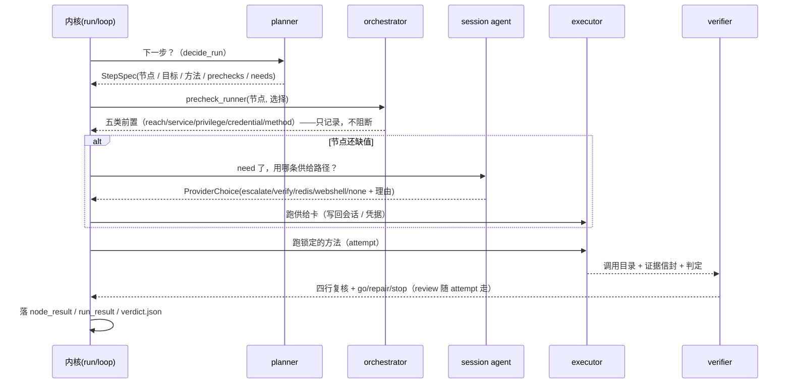

# Agent 层契约（D32）：四个角色、最小必要验证、干跑政策

一句话：**图定主线，LLM 只在边内**。agent 层不是第二个循环——运行内核（`runtime.run` 的决定表 +
`runtime.loop` 的尝试表）原样保留；这一层是包在内核外面的**角色契约**：谁决定下一步、谁去打、
谁只读复核、谁管会话账本，以及它们之间交换什么形状的数据。

配套读：[`skill_contract.md`](skill_contract.md)（技能卡契约）、[`runtime_data_contract.md`](runtime_data_contract.md)
（运行层最小编织契约）、[`skill_retrieval_execution_flow.md`](skill_retrieval_execution_flow.md)（召回→执行流程）、
[`multi_agent_orchestration_prd.md`](multi_agent_orchestration_prd.md)（需求与设计）。

## 0. 一页纸

| 层 | 是什么 | 真源 | 谁驱动 |
| --- | --- | --- | --- |
| 图 | 攻击步骤 + 事实（唯一的事实来源） | 攻击图 JSON（`output/hongri7/json/*.action_graph.json`） | 输入，只读 |
| 内核 | 决定表（先满足前提再执行）+ 尝试表（重试/换方法/停） | `src/runtime/run.py` / `src/runtime/loop.py` | `scripts/run_path.py` |
| **agent 层** | 四个角色 + 编排器：下一步（planner）/ 打（executor）/ 复核（verifier）/ 会话（session agent） | `src/agents/*.py` | `scripts/run_agent.py` |
| **模型接缝** | 边内三选一：哪张候选卡 / 哪条 provider / 下一步试什么 | `src/agents/model.py` | `scripts/run_agent.py --model`（默认关） |
| 证据 | 一次调用的目录：inputs / envelope / judgement / stdout | `output/runs/<run>/**/call-*/` | 执行层落盘 |

## 1. 四个角色：做什么，绝不做**什么**

| 角色 | 问的问题 | 输入 | 输出 | 绝不做什么 |
| --- | --- | --- | --- | --- |
| **planner**（`agents/planner.py`） | 按图，下一步做什么？ | 图 + 运行状态 + 选择器输出 | `StepSpec`（步骤、节点、目标、锁定的方法、prechecks、还缺哪些值） | 不写图、不选工具（选择器选）、不发明事实 |
| **executor**（运行内核 + 适配器） | 怎么打，留什么证据？ | 锁定的方法 + 绑定好的输入 | 调用目录 + 证据信封 + 判定 | **不判成功**（「工具跑了」≠「节点被证明了」） |
| **verifier**（`agents/verifier.py`） | 这条证据链站得住吗？ | `StepSpec` + 这次 attempt（执行状态 / 证据 / 判定） | 四行复核 + 裁决 `go/repair/stop` + 一个可执行的修复动作 | 不碰靶场、不补观测、不改判定（判定器是程序） |
| **session agent**（`agents/session_agent.py`） | 这条会话 / 凭据拿谁去补？ | 运行状态（持有的会话 / 通道 / 凭据）+ 节点 + 选择器输出 | `ProviderChoice`（哪条供给路径、为什么）+ 会话账本 `SessionRecord[]` | 不执行、不判成败；账本是**视图**，不是真源 |
| **orchestrator**（`agents/orchestrator.py`） | 按什么顺序问谁，记在哪？ | 内核回调 + 四个角色 | `agent_plan.json` / `run_result.agent` / 每个 call 旁的 `verdict.json` | 自己不裁决、不猜、不省略失败 |

`ROLES = ("planner", "executor", "verifier", "session")`（`agents/contract.py`）。orchestrator 是**壳**不是角色——
它不放进 ROLES，因为它没有判断，只有顺序和记账。

## 2. 一次 step 的时序



复核**骑在 attempt 上**（`loop.Attempt.review`）：换方法时，`next_method` 的理由直接引用复核的结论，
不需要事后从日志里倒推「当时为什么换」。

## 3. 最小必要验证（precheck）：五类、三模式、三态

规则来自 D31 的定案：**前提是参考和追溯，不是闸门**。所以 precheck 永远不阻断执行；它只在节点失败时
被引用，回答「哪条前提从一开始就没成立」。

| 家族 | 问什么 | 模式 | 谁回答 | 落在哪 |
| --- | --- | --- | --- | --- |
| `reach` | 这个地址端口通不通 | `program`（唯一真上线的一类） | 执行主机上的 `nc -z -w 3 <ip> <port>` | `observation{argv,returncode,stdout,stderr}` |
| `service` | 图说这台主机有这个服务 | `graph`（登记，不探） | 图声明 | `status=unknown` + note（图声明；线上还没开口） |
| `privilege` | 节点要的等级，运行现场已经拿到了吗 | `logic` | `runtime.identity`（`tier_of` / `satisfies`） | `observation{held,wanted}` |
| `credential` | 这个方法要花的账号，账本里有吗 | `logic` | 运行状态 `state.credentials` | `observation{account}` 或 `missing` |
| `method` | 这个 case 有没有可选的卡 | `logic` | 选择器 `candidates[]` / `excluded[]` | `observation{candidates,ready}` 或点名缺的事实 |

三态（`ok` / `missing` / `unknown`）：**不知道就写 unknown**，不写成 ok。探针崩了也是 unknown（`the probe failed: ...`）。
`declared` 只说明「这条前提是图自己写的（true）」还是「planner 从节点语义派生的（false）」——它是**标注**，不是开关。

## 4. 复核四行与三值裁决

| 行 | 看什么 | 通过条件 | 失败时 |
| --- | --- | --- | --- |
| `freshness` | 证据锚点是不是**这一次**调用的 | 判定的 `call_id` == 本次调用 | 裁决 **stop**：证据不是这次的，没什么可修 |
| `target` | 观测到的是不是**这台**目标 | judgement 的 target 闸 pass（有观测且对上） | 记 `unknown`，升级为 repair |
| `identity` | 这次的身份够不够 | 判定给出的身份满足节点要求；**没有会话上下文时写 `n/a`**（不冒充通过） | repair + 建议 `escalate: ...` |
| `effect` | 节点要的效果真的产出了吗 | effect 闸 pass | repair |

裁决词表：`go`（链成立）/ `repair`（不成立，但还有下一手）/ `stop`（不成立，也没什么可改）。
`repair.action` 只有两个，且**必须是循环能执行的**——词表就是 `agents/contract.py::LOOP_REPAIRS`，
每条都写明它对应循环的哪条决策：`retry`（同一方法重试，只给 `timeout` / `transport_error`）→ `retry_run`、
`next_method`（换下一个候选卡）。**没有 `adjust_inputs`**：输入值只有图事实与运行输入两个来源，run 里不存在
「同一方法换一套输入」这一手——卡绑错了值是图缺事实（`graph_gap`）或运行输入的问题，「值后来才到手」则由
supply 重开节点接管（`runtime.run.MAX_REOPENS`）。更软的东西（比如「升个权」）只写进 `suggestions[]` 当
**建议文本**，永远不当命令——实际驱动由 selector / supply 的等级缺口机制负责。

聚合：`verifier.summarize(node, rows)` 把多行复核压成一个模式词（`target_unmatched` / `identity_short` /
`method_short`），进 `run_result.agent.node_reviews`。

## 5. 数据形状：每样东西落在哪

| 结构 | 内容 | 落地文件 |
| --- | --- | --- |
| `StepSpec` | `step/action/node/node_type/why/target/method/prechecks/needs/evidence_refs`（干跑多一个 `simulated`） | `agent_plan.json.steps[]`；实跑进 `agent.steps[]` |
| `CheckResult` | `kind/key/target/why/mode/declared/status/observation/call` | `run_result.nodes[].prechecks[]` + `agent.prechecks[]` |
| `Verdict` | `node/call/verdict/checks[4]/reason/repair/suggestions/evidence`（+ 写入失败时的 `verdict_file_error`） | 每个调用目录旁的 `verdict.json` + `agent.verdicts[]` |
| `ProviderChoice` | `kind/provider/why/target/required/skill` | `agent.providers[]`（供给跑之前先记账） |
| `SessionRecord` | `host/address/driver/identity/privilege/via/source/call/channel/handoff/pivot` | `session_agent.ledger()` 的返回值（视图，可随 run 重算） |

## 6. 证据落盘与中间记忆：两笔账，分开放

| | 证据（log 那一笔） | 中间记忆（模型 I/O 那一笔） |
| --- | --- | --- |
| 内容 | 调用目录：`call.json` / `envelope.json` / `judgement.json` / `stdout.txt` / `stderr.txt` / `verdict.json` | `StepSpec` / 四行复核 / precheck 行 / provider 行 / node_reviews |
| 粒度 | 可以很细（原文、hex、完整回显） | 只留结论、理由、缺口名（**不放原文**） |
| 用途 | 审计、复盘、失败追溯 | 喂给模型和报告，做下一步决策 |
| 纪律 | 只追加，不覆盖；`material_kept` 标记是否留了原始材料 | 从状态重算即可（无隐藏状态） |

**D32 不做长期记忆**：每次 run 都从图重建世界，跨 run 不攒「经验」。跨靶场要复用的事实应该是**图上的事实**
（或 `assets.json` / `host_ip_map.csv` 这类对账表），不是模型脑内的记忆。长期记忆留给未来需要时再说。

## 7. 两种模式，一条代码路径

| | plan（默认） | live（`--live`） |
| --- | --- | --- |
| 做什么 | 在内存里把整张图走一遍（乐观模拟），写出每一步 | 真连执行主机，逐节点打 |
| 产物 | `agent_plan.json`（每步 `simulated: true`） | `run_result.json` + `agent` 段 + 每个 call 的 `verdict.json` |
| 碰靶场吗 | 不碰（不建连、不发包、不写 state） | 碰（这就是它的用途） |
| precheck | 全部登记，`reach` 记 `unknown`（没上线） | `reach` 默认真探针，`--no-precheck-live` 可关 |

干跑里被「假设成功」的每一步都要留痕，词表固定三条：
`supply assumed for node N: <值>`（假设的运行现场值）、`supply assumed for node N: <host>:<user>`（假设的凭据）、
`graph gap crossed at node N: the candidate misses <事实>`（跨过的图缺口）。**模拟就是模拟，不许混进证据。**

## 8. 入口与文件

| 文件 | 作用 |
| --- | --- |
| `src/agents/contract.py` | 词表与数据形状（ROLES / CHECK_KINDS / CHECK_MODES / verdict / repair / dataclass） |
| `src/agents/planner.py` | 图求值器：下一步 + `StepSpec` + precheck 生成 |
| `src/agents/verifier.py` | 只读复核：四行 + 裁决 + 修复动作 + 模式聚合 |
| `src/agents/session_agent.py` | 会话账本 + provider 决策（五档顺序）+ 凭据缺口 |
| `src/agents/orchestrator.py` | 干走（`plan_run`）/ 复核钩子 / precheck 钩子 / provider 记账 / `agent_report` |
| `scripts/run_agent.py` | CLI：默认干跑，`--live` 实跑；其余参数与 `run_path.py` 同款 |
| `src/agents/model.py` | 模型接缝：三个任务、验证器、脱敏、提示词、HTTP 客户端、`agent.model` 记录 |
| `tests/test_agents.py` | 60 条离线测试（契约 / 规划 / 复核 / 会话 / 编排 / 模型接线 / 修复词表守线） |
| `tests/test_model_seam.py` | 39 条离线测试（验证器 / 脱敏 / 解析 / 重试 / 落盘；假客户端 + 注入 opener，零网络） |

## 9. 不变量（改代码前先读这一节）

1. **planner 只读图**：没有任何一条路径可以从 agent 层往图里写事实。图缺口只能回图侧补。
2. **verifier 不碰靶场**：复核只读已经落盘的东西，不补一次「再确认」的调用。
3. **precheck 永不阻断**：五类前置都可以失败，节点照跑（D31）。
4. **证据不足就写不足**：`unknown` / `uncertain` / `n/a` 是合法答案，不许往 `pass` 上贴。
5. **模拟必须标出来**：`simulated: true` + 三条假设 note；干跑产物不得当成证据引用。
6. **账本是视图**：`SessionRecord` 从状态重算，任何地方都不许把它当输入反写状态。
7. **repair 只有两个动作**（`contract.LOOP_REPAIRS`，逐条对应循环决策），且必须是循环能执行的；其余一律 `suggestions`。
8. **freshness 失败 = stop**：证据不新鲜时没有「修一下再试」这一说。
9. **provider 先记账后执行**：`agent.providers[]` 在供给跑之前写入（记的是决策，不是结果）。

## 10. 现在的边界（D32 老实交代）

- 四个角色目前都是**确定性规则**（图求值器 / 四行复核 / 五档 provider）。LLM 还没进来当决策者；
  契约先把「边内」的位置固定下来，模型后续接的是同一批输入输出，不动内核。
- 没有跨 run 长期记忆（见 §6，有意为之）。
- 首跑与复盘抓到两个真缺陷（`summarize` 把成功节点标成失败、`reach` 对端口字符串 `none` 发探针），都已修复并带回归测试。
- **D32-h 又抓到两个真缺陷**（都在这层里）：① 会话供给的探针把 requirement 指向**节点目标**而不是**通道宿主**，跨主机节点
  （pc1→dc / pc1→pc2）因此永远核不过（修在 `run_path.channel_address` / `session_requirements`）；② 交给卡的 `credential_ref.user`
  用了 MulVAL 的**角色名**而不是凭据条目里的**登录名**，目标端回「未知的用户名或错误密码」（修在 `selector._credential_from_facts`）。
  两条都带回归测试，见 `validation_runs.md` 的 D32-h 节。
- 图侧那两个口子的现状：节点 2 的图缺口**已闭**（`rules5_v2.P` 就地补凭据 + case
  `disable_firewall_credentialed`）；节点 41 的解析链仍然只拿到 `bunny` / `PC1$` —— D34 把它
  重定案为**目标状态缺口**（LSASS 只留采集时刻活着的会话，不是工具缺口），域管改走**显式运行输入**
  （`run_context.domain_admin.json` + 可提交模板 `data/samples/hongri7_run/`），并作为**技能缺口**
  记在 `skill_backlog.md` 第 1 条。这一层不假装解析链拿到了它。

## 11. 怎么证明这层没跑偏（可复核的验收）

| 证据 | 位置 |
| --- | --- |
| 105 条 agent 层离线测试（61 条角色与编排 + 44 条模型接缝） | `tests/test_agents.py`、`tests/test_model_seam.py`（全量 760 passed, 1 skipped） |
| 真图干跑 14 步（含 16 条假设 note） | `output/runs/D32-plan/agent_plan.json` |
| 真证据复核（D29-full3 节点 41）：`target=unknown` → repair / next_method | `output/runs/D29-full3/node-41/attempt-3-credential.parse.minidump_pypykatz/call-20260916T033747-344f9a/` |
| 实机整图三跑（`--live`，与 `D31-path3` 逐节点一致） | `output/runs/D32-live3/run_result.json` 的 `agent` 段（10 条复核全 `go`、9 个节点 30 行前置、5 条 provider 决策；见 `validation_runs.md` 的 D32 节） |
| **整图全绿一跑**（`--live`，14 个输出节点全部 settled） | `output/runs/D32h-live3/run_result.json`：`status=succeeded` / `action=done_all` / `graph_gaps=[]` / `skill_gaps=[]`；节点 2（24.3s）与 44（8.9s）/ 48（9.0s）的 `judgement.json` 见 `validation_runs.md` 的 D32-h 节 |
| 两个 D32-h 缺陷的回归 | `tests/test_run_path_supply.py`（23 条，含「跨主机节点探的是通道宿主」3 条）、`tests/test_selector.py`（含「凭据条目自带登录名优先」1 条） |
| 会话账本随报告输出（state 给定时 `run_result.agent.sessions`，含迁移计划 `handoff`） | `tests/test_agents.py` 的 ledger / report 两条测试；实跑产物见 `run_result.json` 的 `agent.sessions` 段 |
| D35 接线没有动内核：干跑的 `steps` / `notes` 与 D32-h 基线**全等** | `output/runs/D35-plan/agent_plan.json` vs `output/runs/D32h-plan/agent_plan.json` |

## 12. 模型接缝（D35 / D50）：边内选择题与装配题，其余的都不许碰

一句话：**内核里没有模型**。模型只在四个接缝上答题，每个接缝都先有确定性答案 —— 三个选择题是「在已经算出来的菜单里挑一个」，第四个（D50）是「按卡片的模板把命令行拼出来」，两者都不是在菜单外发明。

| 接缝 | 问的问题 | 菜单从哪来（规则先算） | 模型**不能**做什么 |
| --- | --- | --- | --- |
| `pick_method` | 这一步用哪张卡？ | 选择器排好序、且 `ready`（图上的事实一条不缺）的候选 | 不能加候选、不能选 `ready=false` 的、不能改输入绑定（输入 refs 跟着选中的卡走） |
| `choose_provider` | 这条会话 / 这个值由谁供给？ | session agent 算出的「前提成立」的 provider 列表 | 不能发明当前事实不支持的 provider（图上没有 redis 服务，`redis` 就不在菜单里） |
| `prefer_repair` | 下一步试什么？ | `verifier.repair_options`：节点循环真能执行的动作 | 不能改裁决（`go` / `repair` / `stop` 是程序算的），不能把 `unsatisfied` 说成通过 |
| `assemble_command`（D50） | 这张 `assembly=model` 的命令行怎么写？ | `runtime.assembly.brief(...)`：卡片 §怎么做 + 参数契约 + marker 纪律（**材料值不在简报里**，只给形状提示） | 不能写运行层没绑定的占位符、不能自造 marker、不能在 shell 通道上交多行命令；它不产生证据，也不产生裁决 |

**闸门（D37）：菜单只有一行时不问。** 这条只管三个选择题接缝；`assemble_command` 不是选择题（规则答案是模板首行、模型答废时规则接手），所以没有「单选项提问」这回事。 一行菜单是**被迫的选择**，不是决策 —— 把它记成模型决策，报告就开始说谎。
三个接缝同一条规则（`pick_method` 的 `ready` 候选 ≥ 2、`choose_provider` 的前提成立 provider ≥ 2、
`prefer_repair` 的循环可执行动作 ≥ 2）。实证：`D37-live` 整图 5 次 provider 提问**全是单选项**（12.8 s、0 信息量），
补上闸门后 `D37-live2` 的 provider 提问 **0 次**，而节点结论与上一跑逐节点一致。

四条纪律（都在 `src/agents/model.py` 里，改代码前先读）：

1. **规则优先**：确定性答案永远先算。没配模型、模型慢了、模型跑飞了、答案被拒了 —— 跑的都是规则那一个。
   `ModelSeam` 的每个方法都不抛异常，菜单再烂也只是「没有答案」。
2. **验证后才采纳**：答案先过纯函数验证器（在候选里吗？provider 成立吗？动作循环能执行吗？）。
   拒绝要落记录（`rejected` 一句话 + `reply` 原文），绝不半应用。
3. **原始数据不进提示词**：提示词只从 `_clean` 出来的结构里拼（键名规则见 `SECRET_KEYS`，形状规则见
   `runtime.redact`）；凭据只留「持有」这件事（`<held>`），密钥形状的串变 `<redacted>`。
   证据留在 call 目录，不下发给第三方 API。
4. **一次调用一件物证**：prompt / reply / 决策写进 `<run-dir>/model/model-NNN-<task>.json`；
   `run_result.agent.model` 里只放摘要与行（client / tasks / calls / summary / rows，每行带节点号）。
   转录写不进去时**不吞异常**：`record_failures` 带上文件名与 OSError 原文 —— 运行照常，缺口可见。

两条硬边界（和 §9 同级的不变量）：

- **模型不改图、不改裁决、不加能力**：它挑的只能是「已经算出来的东西」；它和规则不一致时，分歧落在
  `model_disagrees` 上给人看，**不改变跑法**。
- **干跑不叫模型**：plan 模式是确定性预测，接缝只在真跑的 step 里说话（`--live`），所以
  `agent_plan.json` 里没有模型痕迹。

入口（`scripts/run_agent.py`）：

```
python scripts/run_agent.py --live --graph ... --remote kali@192.168.52.128 --password kali     --model gpt-4o-mini --model-base-url https://api.openai.com/v1     --model-tasks pick_method,choose_provider,prefer_repair
```

| 参数 | 默认 | 说明 |
| --- | --- | --- |
| `--model` | 空（rules only） | 模型名；空 = `NoModel`，行为与 D32 的纯规则完全一致 |
| `--model-base-url` | `https://api.openai.com/v1` | OpenAI 兼容的 `/chat/completions` |
| `--model-api-key-env` | `AGV_MODEL_API_KEY` | key 只从环境变量读，绝不进命令行、绝不进日志 |
| `--model-tasks` | 三合一 | 只让一部分接缝说话（名单外的接缝一律走规则） |
| `--model-timeout` / `--model-retries` | 60s / 2 | 传输错误、429、5xx **和空回答**才重试；4xx 报一次不再打（重试没用）。空回答 = 推理模型把预算烧在思考上（D37 实机：`completion_tokens == max_tokens` 且 `content` 为空），重试次数落在 transcript 的 `reply.attempts` 上 |
| `--model-max-tokens` | 12000 | 每次提问的完成预算（推理 token 也算在内）；预算烧尽被截断（`finish_reason=length`）或空答 → 该答案被拒、不解析不派发（选择类接缝规则接手，生成类接缝直接停），`model.jsonl` 记 `finish_reason`。2026-09-22 现场：`generate_post` 烧满 1600（2382 reasoning + content 需 4000 才出 `stop`）→ 定 4000；2026-09-23 现场：`generate_pre_checks` 同 prompt 三次调用推理 5838／6293／>8000 tokens（长度波动属实），8000 首次实跑仍截断 → 定 12000 并实机跑通 |
| `--model-transcript` / `--no-model-transcript` | `<run-dir>/model` | 每次调用的 prompt / reply 落盘位置 |

`scripts/run_node.py` 也开了同一套开关（`--model` / `--model-base-url` / `--model-api-key-env` / `--model-timeout`），它只用来跑**装配题**：节点的三选择题仍由 `run_agent.py` 那条路问。

零新依赖：`urllib` 一个 `POST`，`temperature=0` + `response_format=json_object`（对方不遵守也得过验证器）。
测试全离线：`tests/test_model_seam.py` 用假客户端与注入的 opener，不需要 key、不需要网络、不需要模型。


## 2026-10-04：模型整图覆盖与未决恢复（010，覆盖冲突旧条款）

模型规划轮开始时，从图冻结 required_node_ids（AND 节点集合；已声明运行范围时用该范围），并写入 planner checkpoint。完成数、分母和恢复后的覆盖集合不得来自模型已访问节点。非空图直接 stop、只跑部分节点后 stop，均为 `PLANNER_COVERAGE_INCOMPLETE`；显式 skipped 有独立理由并保留在闭合统计中，但整图不得声称 succeeded。

uncertain、RECONCILING、unknown effect 不进入 completed_node_ids/failed_node_ids。规划器可以再次选择该节点，但运行侧只能调用 reconcile_runner 读取原动作记录；缺恢复入口给出 `RECONCILIATION_RUNNER_UNAVAILABLE`，缺动作引用给出 `ORIGINAL_OPERATION_REFERENCE_UNAVAILABLE`，缺后端查询给出 `ORIGINAL_OPERATION_QUERY_UNAVAILABLE`。未决节点不能被 skipped 掩盖，也不能重新选卡后重发变更动作。

`scripts/run_agent.make_reconcile_runner(query_original=...)` 读取节点各尝试保留的 stage 目录，按固定的原卡/工具/输入恢复并查询原 operation。CLI 默认没有后端原调用查询适配器时具名暂停。迟到回执结清返回 `ORIGINAL_OPERATION_SETTLED_VERIFICATION_REQUIRED`，不自动完成节点；独立验证给出节点终态后才可进入 completed。预算、未决义务和原证据随恢复继续，重启不是新额度。
