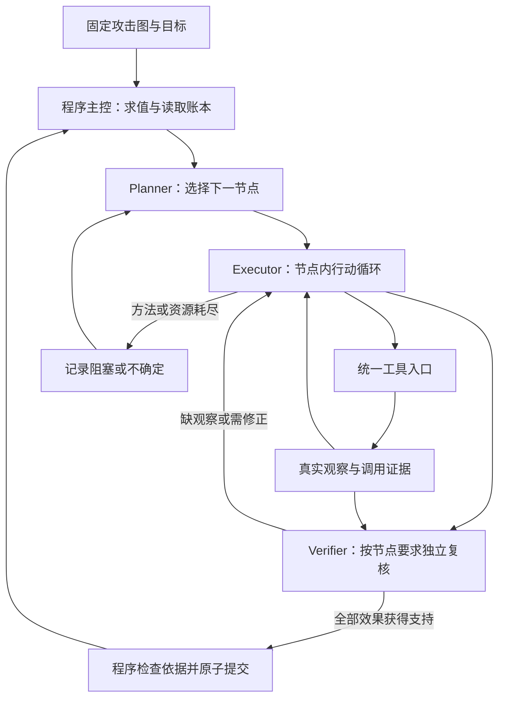

# 三 Agent 架构审阅与执行器完整方案

日期：2026-09-30。性质：代码审阅与设计建议，不表示新执行器已实现或实机通过。

审阅对象是用户指定的 `E:/Desktop/ai/skill/attack-graph-validation-agent`。起始提交为 `826ca8b`，包括当时未提交的执行器改动；审阅期间外部会话将其提交为 `f7a6a19`。本轮不改既有实现，以本文提出新的设计边界。

## 1. 结论与变更边界

**保留攻击图、技能知识、真实执行与证据账本；把节点内部的行动选择和反馈修正交给 Executor，把证据语义裁决交给 Verifier。**

当前问题并非代码太确定性。工具执行、图求值、证据保存和事务提交本来就应该由程序完成。问题是程序同时拥有行动策略和全部判断，模型的一部分选择又没有接到实际派发上，角色名称因而超过了角色能力。

问题：多个入口并存，模型选择未完整生效，执行器缺少贯穿真实观察的自主反馈循环。

目标：Planner、Executor、Verifier 三个独立上下文，单进程串行主控，一条完整的节点执行闭环。

范围：在输入的攻击图内规划、执行、复核；按当前节点要求做定向补观察、选择已有方法、调整方法参数和准备必要执行资源。

非目标：新攻击面发现、开放式扫描探索、跨运行记忆、分布式 Agent 总线、通用自动渗透平台、为未来能力先造接口。

默认设计假设：Planner 在给定图内为指定目标选路。若验收要求是固定路径复现或全部行动覆盖，应采用下文第 3 节相应的完成条件；三者不能共用同一个成功分母。这个产品选择仍应由用户确定。

验收重点：模型选择能改变实际执行；模型根据真实反馈进行修正；Verifier 可以否决 Executor 的完成主张；成功节点具有完整效果依据；中断后不盲目重放未知操作。

## 2. 已核实的实际问题

所有路径相对项目根目录，行号对应本次审阅的实现。

| 优先级 | 发现与证据 | 影响与处理方向 |
|---|---|---|
| P0 | `src/agents/orchestrator.py:423-429` 修改 `selection.locked/inputs`；`src/runtime/loop.py:194-201,372-380` 却从原候选列表的第一个可用项开始；`scripts/run_path.py:1066-1074` 的普通卡路径原样交接该列表 | 普通节点中，模型改选未成为执行循环的首选。链路径会读取 locked，是例外。应先修复真实派发读取决策的问题 |
| P0 | `src/agents/orchestrator.py:205-211` 将 `prefer_repair` 写入报告；`src/runtime/loop.py:242,275-290,334-342` 仍按规则决定动作，复核信息只进入说明 | 模型建议换方法，程序仍可重试原方法。需要把修正作为下一轮行动输入，而非报告装饰 |
| P1 | `scripts/run_node.py:183` 的执行工厂接受 `seam`；整图入口在 `scripts/run_path.py:1008` 调用它时没有传入 seam | 单节点命令装配能力与整图模型入口没有贯通。不能根据单节点模型测试宣称整图执行器已由模型决策 |
| P1 | `src/agents/planning_pipeline.py:193-219` 只到 Planner→E1；E2/E3 有独立 CLI；`src/runtime/e5.py:41` 只有输出解析器 | 阶段文件和规格已相当丰富，完整 Planner→Executor→Verifier→Planner 闭环仍未形成 |
| P1 | `src/runtime/e3.py:134-149,154-170,286-305` 采用已选卡，固定卡直接运行，确认观察仅支持声明的同一固定卡一次复查 | 模型主要在一个已锁定方法内装配，无法自然决定补哪项观察、换何种实现和下一步顺序 |
| P1 | `src/agents/verifier.py:55-83` 是确定性复核函数；`docs/product/executor_big_logic.md:31,53,67-73` 把模型解释限定为不改变判定 | 当前没有承担证据语义裁决的 LLM Verifier。可保留代码检查，但需要给模型复核真实、可被采纳的判断职责 |
| P1 | `scripts/run_path.py:1113` 在执行之后才生成 proposal；`src/runtime/proposal.py:120` 的严格三字段形状与该日志的 source/非空 reason 不同；`src/runtime/run.py:1451-1476` 也未把 proposal 搬入整图结果 | 新 proposal 是初始选择的日志投影，尚非派发消费接口。记录了提案不代表提案驱动了执行，也不能称两边已使用同一可执行契约 |
| P1 | `src/agents/planning_pipeline.py:82-86` 要求全部 AND 完成且目标成立 | 这是全部行动覆盖的完成条件。若产品实际要目标选路，Planner 无法用替代支路避开一个失败节点后结案 |
| P1 | 旧 `loop.py:275-290` 将 timeout 等视为可重试；`run_path.py:997-1018` 有内存级同动作保护，但允许换候选，强制停又受会话管理开关控制（`:1080-1093`） | 不同方法也可能作用于同一未决效果；进程重启会丢失内存保护。新 E2 内核已有持久意图和端点对账，应把该能力接到唯一主执行入口 |

两个决定性问题已用假执行器在本地复现，未连接目标、未运行攻击动作：

```text
locked = model.second
actually_called = rules.first

accepted_model_repair = next_method
actual_loop_action = retry_run
```

这说明需要优先验证“模型回答 → 被采用动作 → 实际调用”的整条链。现有测试中只检查 selection.locked 或字典形状，无法发现执行循环仍读取旧策略的问题。

补充的工程一致性问题：`src/runtime/runner.py:45` 生成宪章要求的调用 ID，而 `src/runtime/e2.py:173-188` 生成另一种阶段 ID。修复方法是首次分配合法 call_id 并持久化，恢复时读取原 ID；不需要靠另一种 ID 形状实现稳定去重。

## 3. 三个角色和一个程序主控

三个 Agent 首先是三个推理职责与三个上下文。可以使用同一模型，不需要三个独立进程。

| 部件 | 真正负责什么 | 不应重复负责什么 |
|---|---|---|
| Planner | 在程序计算的可推进节点中选择下一节点或目标支路；基于已接受结果与阻塞原因调整后续计划 | 重建已有攻击图、编写当前节点命令、相信 Executor 自报的成功 |
| Executor | 理解当前节点任务；选择方法与必要检查；调整方法参数；调用工具；根据观察和复核反馈继续、修正或停止 | 改图目标、伪造调用结果、直接提交节点成功 |
| Verifier | 独立审阅原始调用和实际效果；判断每项要求是否获得支持；提出缺失观察和诊断；可请求定向确认检查 | 沿用 Executor 的结论作为证据、替 Executor 决定全部实施步骤 |
| 程序主控 | 图依赖求值、材料读取、调用派发、资源账本、预算、证据关联、恢复与一次性提交 | 在 Agent 模式中预先锁死所有方法、修正动作和语义结论 |



Session Agent 收成普通资源管理模块：提供查询、核对、登记。Orchestrator 收成程序主控。涉及选择资源准备方法的推理由 Executor 完成，已有资源核对流程仍由代码执行。

Planner 没有必要在只有一个明确可推进节点时再次调用模型。Executor 即使只有一种主动作，也可能需要选择前检查、资源准备、复查和停止；不能把“只有一张动作卡”误当成“整个节点没有模型决策”。

完成条件必须明确：

- **目标选路**：所选目标的全部必需效果被证实；未走的替代支路记未执行，不影响目标成功。
- **固定路径复现**：输入路径上每个要求执行的行动节点完成；路径外节点不进入成功分母。
- **全部行动覆盖**：逐个记录全部行动的结果；“覆盖完成”表示有结论，不表示所有行动成功。blocked/uncertain 应原样统计。

第一版不再为这三种语义各建一套运行引擎。先实现用户选定的一种，现有覆盖脚本保留为评测用途。

## 4. 执行器完整方案

### 4.1 接到的是一个节点任务

任务内容直接来自固定图和当前账本：run_id、node_id、目标主体、当前前提、全部必需效果、可用执行位置与会话、已有凭据引用、当前节点历史、剩余预算。

这些内容是读取视图，保留现有节点 ID 和事实引用，不另存一份 TaskSpec、阶段任务树或模型专属图。全图由 Planner 使用；Executor 能读取本节点和必要依赖，不需要每轮复制整图。

逻辑目标固定，连接地址由输入映射和资源账本解析。方法参数可以调整，例如工具选项、确认方式、脚本写法、已声明的可调路径和超时；目标主体和凭据材料不由模型重新编造。会话可从账本中选择，但执行位置必须与任务要求一致。

### 4.2 检索提供方法材料，Executor 决定如何使用

保留 selector 的精确匹配、类型和资源兼容判断；返回当前节点可用的候选，以及暂不可用的方法和实际缺口。取消“在 Agent 模式中检索一结束就永久锁定一张卡”。

Executor 获取相关 SKILL.md 方法说明，并决定：先检查何种前提、调用哪张卡、是否准备通道、使用何种方法参数、观察后是否换方法。

不能满足硬前提的卡不派发；缺材料也不直接等价于整个节点不可继续。模型可以使用当前节点允许的定向检查补足可观察信息，或准备已知资源，之后重新检查兼容性。它不能凭想象补一个凭据或新图事实。

### 4.3 第一版暴露少量真正执行的工具

| 模型可调用项 | 程序执行行为 |
|---|---|
| `run_skill(skill_id, inputs)` | 解析同一技能契约与资源引用，经现有适配器、远端执行器和统一证据记录执行；返回调用身份、执行状态与真实观察 |
| `read_evidence(call_id, file, locator)` | 按调用引用读取 stdout/stderr/结构化观察或实际实施源码的指定片段；标明完整、截断或脱敏 |
| `request_review()` | 程序将本节点全部已记录调用、实际实施、原始片段、已知冲突与要求交给 Verifier；Executor 不能通过只传有利 call_ids 隐藏失败调用 |
| `finish_blocked(reason)` | 提出无法继续的原因；程序记录节点结果并返回 Planner，不变成目标失败的伪证据 |

后两项是控制交接，不执行远端操作。查询技能材料可由节点上下文直接提供，35 张卡暂不需要再建搜索服务。

第一版采用现有技能工具入口，不新增自由 shell、全新插件协议或通用代码 Agent。已有 model 卡的代码装配可以沿用内部渲染能力；固定卡同样由 Executor 选择调用。**fixed/model 区分工具如何装配，不决定策略由谁控制。**

模型不必每次重写成熟命令。调用一个确定性工具仍然是有效的 Agent 行动，前提是它决定何时调用、如何参数化、如何根据结果改变下一步。

工具接口使用当前模型客户端支持的结构化调用。一种动作只维护一份采用形状；支持原生 tool calling 时使用同一工具定义。不同时保留四字段模型动作、三字段内部动作、另一份规则提案三套公开协议。

### 4.4 每次调用都返回可用于下一步的观察

反馈至少包含实际执行位置、实际采用参数的公开视图、执行生命周期、退出码、原始输出片段、结构化解析结果、可回查的证据位置。

不能只给 `status + reason`。否则模型没有足够信息判断是参数不适配、工具缺失、观察不足，还是动作明确不满足要求。

原文只保存一份，遵守现有材料保护策略。模型视图可以压缩或脱敏，但必须指出省略内容，Verifier 可以回查允许读取的原文。大输出按需读，不把整图日志持续堆进三个模型上下文。

执行生命周期与业务结论分开。正常结束不是效果成功；调用失败也不一定是节点命题被反证。方法不能完成目标，和目标本身不成立，是两个不同判断。

### 4.5 节点内部使用同一个反馈循环

接任务 → 读材料与历史 → 提出下一工具调用 → 程序采用并执行 → 获得真实观察 → 继续或请求复核 → 依据反馈修正 → 复核接纳后提交。

E2 前检查、E3 主动作、E5 修正成为这个循环中的行为类型，保留阶段标签用于审计，不再分别要求模型写互相转换的候选文件。前提检查仍存在，其程序可核对部分保持确定性；不要求模型反复生成固定检查模板。

现有方法链保留为可调用的成熟组合。模型可以选择组合或分步执行；组合中的副作用调用也要各自有证据身份与恢复依据，不能把模型的一次回答当成只有一次实际操作。

明确失败、缺少观察和未知执行结果分别处理：

- 方法已经结束且失败：Executor 可调整方法参数、换兼容方法或指出资源缺口。
- 方法已经结束但效果不明：Verifier 指出缺失要求；Executor 或 Verifier 请求定向观察。
- 原方法可能仍在运行或是否执行未知：主控进入对账；查原端点任务和目标效果。不能直接换另一张作用于相同效果的卡。

全节点只保留一套工具调用预算和时间期限，按需加费用上限；不分别叠加 E2/E3/E5 次数、修正 token、复杂代币和多层审批状态。预算耗尽后保留已有证据，缺证据就是 uncertain。

### 4.6 Verifier 获得真实的判断职责

稳定 JSON/XML 和已验证的确定性判据继续由代码处理。明确的结构化反证不能被模型的流畅解释覆盖。

对不稳定文本、跨调用证据组合、现场差异和缺失观察，Verifier 负责语义判断。它首先查看任务要求、实际 argv/生成源码、运行层关联信息和真实输出，形成独立意见后再看 Executor 的完成主张，减少结论锚定。

Verifier 的最小输出围绕原图效果：

- 每个 effect_ref 的 true / false / null；
- 每项判断的原始证据引用与简短依据；
- 尚缺什么观察，以及需要补查还是建议修正方法。

没有证据的要求为 null。提出新的确认检查时，只允许使用当前节点的定向观察能力；不是给 Verifier 另开一套攻击规划系统。确认调用由同一派发入口执行、同样计预算和保存证据。

程序接纳时检查证据真实存在、属于本次任务、输出完整性、主体与执行位置、未决操作、所有必需效果的覆盖及已知明确冲突。之后原子提交节点结果和资源登记。

**程序不再重写一套语义解释器去重复模型的全部判断。** 结构校验不能证明模型推理必然正确：规则判断与模型复核必须标注各自来源，模型引用合法也可能推错。错误接纳率应由独立实验评估。

尤其要检查“自印成功”问题：Executor 生成的代码打印某个成功字符串，只能证明该代码打印过文本。真实目标效果需要与实施独立的效果观察或可靠工具读回。call_id 能证明记录关联，不能单独证明 stdout 的语义。

### 4.7 只有主控提交结果

Executor 提出完成，Verifier 判断依据是否支持，程序主控负责事实入账。节点的全部必需效果获得支持后，成功结果、证据引用和资源登记同一事务提交；部分效果先保留观察，不提前将节点当成成功解锁后继。

原始调用证据不可被模型修改。登记会话要基于运行层实际返回并核对过的句柄与主体，不能靠模型写出一个 session_ref。

模型故障在 Agent 模式中明确停止或暂停，不静默切换到规则后继续宣称 Agent 成功。确定性执行器保留为显式评测基线；两种策略共用工具与证据内核，不复制运行引擎。

## 5. 最小运行内核与恢复

继续使用现有 stdlib、远端执行器、会话客户端、卡适配器和证据机制。SQLite 适合当前单进程本地运行；不引入 PostgreSQL、消息队列、分布式租约或 Agent RPC。

运行级持久信息沿用现有三表方向，改为 SQLite：runs 保存输入快照、目标、预算、状态和当前工作引用；node_runs 保存原图行动节点的结论；records 保存模型调用、工具调用和复核依据。原始 stdout/stderr/call.json 仍在 call 目录，records 引用它们，不再复制一套大输出。

E2 内核现有的持久意图、端点接受、唯一启动、结果回执和显式恢复值得保留。`Kernel.allowed()` 当前限制一次 adoption 一个 action（`src/runtime/e2_kernel.py:422-472`），不能原封不动当节点多轮 Agent 循环。重构其阶段调度限制，复用执行和对账机制；让每次实际工具调用具有独立持久身份。

顺序为：采用动作并分配 call_id → 保存执行意图 → 派发 → 保存真实回执与原始证据 → 解析/复核 → 提交结论。模型调用和远端等待在数据库事务之外。

恢复时读取最近已提交状态与未决调用：

1. 已有完整结果：继续解析或复核，不再派发原动作。
2. 远端报告仍在运行：等待或按已有取消机制处理，不将其当失败重试。
3. 能确认尚未开始：可重新提出行动，记录新的调用。
4. 无法确认：暂停并保留 unknown；可查原任务和做定向读回，不进行可能冲突的状态修改。

恢复的是记录和工作阶段，不声称复原模型内部思考。迟到结果仍归原 call_id，不能覆盖新的尝试。远端取消未确认完成时也属于未决操作。

去重和不重放可以保证调用身份及提交一致性；对于任意外部工具，不能承诺目标副作用绝对 exactly-once。这个限制比再增加若干事务名更重要。

## 6. 删、合并和保留

| 处理 | 具体内容 | 原因 |
|---|---|---|
| 删除正式执行路径中的规则策略接管 | 锁卡后的强制首选、固定 retry/next_method 表、模型失败的自动规则回落 | Agent 模式必须由模型行动决定下一次派发；规则模式单独作基线 |
| 合并 | E2/E3/E5 分阶段提案与解析、多个结构相近的 ActionProposal、同义状态在多层的翻译 | 一个节点循环、一个工具采用形状即可表达它们 |
| 收成普通模块 | Session Agent、Orchestrator、参数绑定与检索 | 这些工作多数是资源管理与程序调度，不需要新增模型角色 |
| 取消强制约束 | “无集合也要填全部 null”、可执行动作 reason 必须 null、按数组顺序隐含叶身份 | 校验真正使用的字段；判断引用原图 ID，减少位置耦合和无价值格式拒绝 |
| 去掉首版平台设计 | PostgreSQL 草案、多 Agent 总线、未来自动渗透接口、统一强制转 MSF 的资源流程 | 当前环境与已有会话足够完成节点任务；按执行能力选资源 |
| 归档重复口径 | 历史 PRD 与当前规格中的行为冲突，过时角色描述和测试基线数字 | 一份当前架构、一份行为契约、一份运行证据入口；历史文档清楚标注 |
| 保留 | 图 AND/OR 逻辑、目标主体与地址映射、资源绑定、凭据保护 | 这是项目精髓与执行边界 |
| 保留 | call 目录、真实调用关联、预算、超时/取消、持久意图、未决对账、唯一提交 | 这些提供可审计性和事故恢复，不属于可以随意删的防御代码 |
| 保留并去重 | 领域解析器、确定性判据、完整节点效果检查 | 稳定格式由代码处理更可靠；Verifier 和 Checker 不再重复维护同一判据 |
| 保留并改验证重点 | 回归测试、索引检查、故障场景测试 | 不以删除测试数量达成简化，优先补真实决策被消费的端到端检查 |

技能卡不需要全部改成 model 装配。SKILL.md 是方法知识，skill.json 是工具参数与运行声明，复杂 entry.py 是成熟方法实现。简单声明式卡也不需要为了“三件套”补一个无用 entry.py。

“现场语义→参数/变体”先由 Executor 利用观察和现有卡参数完成，不另造万能现场适配引擎。若相同逻辑在多个真实方法中重复，再提取共同代码。

宪章应同步调整：阶段一明确为“固定图语义与目标边界，节点内模型决策执行”；分工地图采用三 Agent；旧的“模型只有三个可选接缝”不再作为新系统定义。证据、诚实失败和运行层不偷偷重试的质量线继续保留。

## 7. 与同类系统的可核对比较

以下来源于 2026-09-30 查阅的一手论文、官方文档或固定代码快照。这些对照证明公开设计，不代表它们已通过本项目的生产评审要求。

| 对照 | 值得借鉴 | 本项目应有的取舍 |
|---|---|---|
| PentestGPT 2024 论文 | reasoning 管整体任务，generation 对子任务使用独立上下文，parsing 整理工具观察 | 已有攻击图不需要重新构建任务树；全图规划与节点执行上下文分离即可。当前仓库主线已更换，不能混用旧论文的成绩与新实现 |
| AutoPentester | 规划、生成、复核与结果反馈分工接近三角色需求 | 作者源码的 verifier 接收模型摘要，自然语言还经模型抽命令。保留角色分工，直接使用结构化工具调用，复核真实证据而非只复核摘要 |
| Inspect | agent/tool/scorer 分离，显式提交完成，工具反馈循环、预算、日志与输入压缩分离 | 借鉴主张与验收分离；样本续跑能力不能当成远端操作副作用恢复 |
| Claude Code | 上下文→行动→检查的动态循环，harness 管工具和上下文，skills 与工具共存 | 借鉴执行循环与按需材料；其文件 checkpoint 不覆盖任意 shell 或远端动作，本项目仍需自己的调用对账 |

来源：

- [PentestGPT，USENIX Security 2024 论文](https://www.usenix.org/system/files/usenixsecurity24-deng.pdf)；[当前 README 固定快照](https://github.com/GreyDGL/PentestGPT/blob/e8b1bb77d1ac00329675cec3b060aba971ec1ac8/README.md)。
- [AutoPentester 论文](https://arxiv.org/html/2510.05605v1)；[作者实现固定快照，Verifier 输入处](https://github.com/YasodGinige/AutoPentester/blob/a4407ed391092b1e602f8948abb8650ba0792242/pentestgpt/utils/pentest_gpt.py#L883)。
- [Inspect ReAct Agent](https://inspect.aisi.org.uk/react-agent.html)；[Inspect 日志与恢复](https://inspect.aisi.org.uk/eval-logs.html)。
- [Claude Code 工作循环](https://code.claude.com/docs/en/how-claude-code-works)；[Checkpoint 的范围](https://code.claude.com/docs/en/checkpointing)。

一般模式也支持这个取舍：Anthropic 将固定代码路径的 workflow 与模型决定步骤和工具使用的 agent 分开，并建议从简单循环构建；LangGraph 的持久化文档提醒重执行与副作用需要特别处理。借鉴这些边界不要求安装对应框架。[Anthropic](https://www.anthropic.com/engineering/building-effective-agents)、[LangGraph 官方执行/恢复说明](https://github.com/langchain-ai/docs/blob/main/src/oss/langgraph/graph-api.mdx)。

## 8. 实施顺序和逐步验收

| 次序 | 最小改动 | 必须看到的行为 |
|---|---|---|
| 1 | 先修普通节点模型选卡和修正的消费问题，接通整图执行器模型入口 | 两个兼容方法中模型选第二个，实际首调就是第二个；修正选择改变下一次派发，日志与实际一致 |
| 2 | 唯一节点执行入口使用持久调用与对账机制；统一 call_id 分配 | 动作结束而协调端中断后，从原回执继续；超时未知时不改方法盲打；预算与调用身份重启后不重置 |
| 3 | E2/E3/E5 收成一个 Executor 循环，卡检索从锁定改为候选材料 | Executor 根据真实输出补检查、改方法参数或换兼容方法；不是只在既定模板内填空 |
| 4 | 接入独立 Verifier 上下文及效果依据，去掉重复语义裁决 | Executor 宣称成功但缺效果时被否决；未结构化文本可以获得有依据的模型复核，记录来源 |
| 5 | 接通 Planner，按用户选定的目标口径结案，归档冲突入口 | 阻塞可以回到 Planner 选图内替代支路；全图日志能串起决策、真实调用与最终效果 |

在步骤 3 后即可开始真模型小规模评测，不应把前三步无限扩展成“契约治理先全部做完”。每步做一条真实纵向链，再扩大方法覆盖。

至少覆盖以下场景：

1. 模型选择改变实际派发与参数，记录中的 selected/actual 能对账。
2. 第一种方法明确失败，模型依据反馈修正或选择第二种，后者实际运行。
3. 输出正常结束但只有“成功”文字，独立效果未支持，节点不能成功。
4. 输出格式变化，稳定解析未覆盖，Verifier 回查原文后给出判断或缺证结论。
5. 部分效果完成，节点保持未成功；完整效果出现后只提交一次。
6. 原动作超时、迟到或协调进程中断，恢复先对账，未决效果不被新方法掩盖。
7. 模型不可用、资源失效或预算耗尽，退出理由明确，已有证据保留。
8. 给定图的可用替代支路能帮助达到目标，覆盖率与目标成功率分别统计。

实验比较三组：现有规则基线、单个 Executor 模型循环、Planner+Executor+Verifier。固定同一图、输入和预算，报告目标成功率、效果错误接纳率、未知状态误重放次数、恢复结果、工具调用数、token/费用与耗时。用工具不可用、输出差异、资源不足等受控环境变化测试模型价值，避免只在既定路线全部顺利时验证“模型也能跑通”。

多个角色共用同一模型可能发生相关错误。独立上下文能减少互相自报污染，不能保证统计独立；额外 Verifier 是否值得其成本，应由错误接纳率实验确认。

## 9. 本轮验证与复核记录

运行命令：`D:/Conda/python.exe -B -X utf8 scripts/ci.py --label architecture-review-20260930`。

结果：pytest **1572 passed / 6 skipped**；活面标记审计 0；35 张技能索引核对通过；该次选取的红日 7 图 12/12 AND 节点有方法覆盖。CI 记录位于 `output/reports/ci/826ca8b-dirty.json`，它对应运行时的工作树，不能拿它代表任何后续实现的验证。

技能实际装配数为 fixed 24 / model 11，和新增大逻辑文档中的 25 / 11 不一致。根 README 与宪章中的旧阶段描述、21 卡和 775/1 等数字也不能作为当前能力证明。

本轮没有实机执行，因此没有新增实机 call_id；本文没有把示意身份或离线假执行器结果写成实机证据。上述 CI 与两条纯内存复现只证明本次检查的边界。

并行复核：roles_audit 核对主流程和模型接线；complexity_audit 核对可简化层和恢复边界；comparators 核对一手来源。二次质询确认：模型选卡失效适用于普通候选循环，不能泛化到读取 locked 的方法链；模型语义裁决可以被程序采用，但合法引用不等于推理必然正确。最终方案采用这两个修正。

核心工程标准是：每次决策能追到实际动作，每次成功能追到实际效果，每次中断能说明做到哪里。角色名、协议数量和测试数量都不能代替这三件事。
