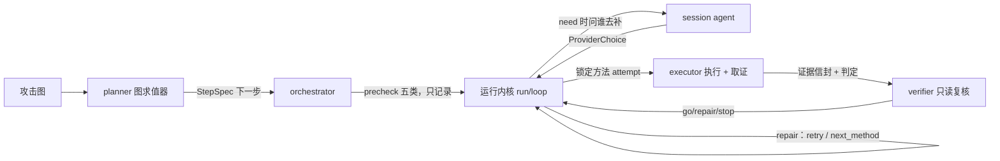

# 多 agent 编排 PRD（D32，落地版）

> 历史草案在 `reference/v0.1-detailed/`、`reference/v0.2-detailed/`（那一版是「主控 + Execution Agent + Session Agent +
> Supervisor」的纸面设计）。本页是**落地版**：写的是仓库里真正跑起来的东西，字段与文件都可核对。
> 契约细节见 [`agent_contract.md`](agent_contract.md)。

## 1. 需求（爷爷的原话）

- 全自动：**人只看结果**。输入攻击图 → agent 自己做自动化验证（任务拆解、工具调用、循环）。
- 循环要真的存在：编排给出「当前要做的步骤」；验证这个步骤的条件是否真实成立；不行就**找问题、改利用方式、再执行**
  （不是「一失败就换一条攻击路径」）。
- 独立的 **session agent**：每到一个新主机，起代理、把会话迁进 msf，方便后续利用与管理。
- 分工要清楚到能不重叠：谁负责打、谁负责验、谁负责说话（会话）。
- 工程级：不做玩具。每一步都要有落盘证据，能复盘、能追溯。

## 2. 设计（三条口径）

| 口径 | 内容 |
| --- | --- |
| **图定主线，LLM 只在边内** | 「该打哪个节点、按什么顺序、节点之间谁是谁的前提」全部由图求值器决定（确定性）。「这条边怎么打、参数填什么、行不行」才是模型和工具的地盘。 |
| **三权分立（D25）** | 执行 / 判定 / 复核分开：执行只打与取证；判定是**程序**（`runtime.checker` 的闸门）；复核只读证据链。任何一环都不许自己给自己打分。 |
| **方向 3（D32 定案）** | 执行层做「打 + 取证」；复核（verifier）只读证据并给裁决；**打之前**的「能不能打」由最小必要验证（precheck）回答，precheck 不阻断、只记录（D31）。 |

## 3. 角色与接缝

| 角色 | 实现 | 接缝（内核怎么叫它） |
| --- | --- | --- |
| planner | `agents/planner.py` | 内核的 `decide_run`；产出 `StepSpec` |
| executor | 运行内核 + `skills/<id>/entry.py` + `runtime.remote` | `node_runner` / `supply_runner` / `chain_dispatch` |
| verifier | `agents/verifier.py` | `run_path.build_node_runner(attempt_reviewer=)` —— 每个 attempt 结束就复核 |
| session agent | `agents/session_agent.py` | 供给入口 `run_supply`（provider 决策 + 会话账本） |
| orchestrator | `agents/orchestrator.py` | 干走 `plan_run` / `precheck_runner` / `on_event` 记账 / `agent_report` |

一次节点执行的顺序（固定，不跳步）：

1. planner 给出下一步（`run_node` / `skip_node` / `aggregate` / …）；
2. 内核检查这个节点缺什么（`missing` = 图缺口，`pending` = 运行现场缺口）；
3. 缺运行现场值就先走供给：session agent 选 provider → 跑供给卡 → 值写回状态；
4. **precheck**：五类前置一次记录（`reach` 真探针；其余逻辑 / 图登记）；
5. **主方法**：链（若有）或单卡；每个 attempt 结束 → verifier 复核 → 复核随 attempt 走；
6. 判定器给判定（程序）→ 复核给裁决（角色）→ 循环按裁决动作（重试 / 换方法 / 换输入 / 停）；
7. 结果落盘：`node_result.json` / `run_result.json` / 每个 call 旁的 `verdict.json`。

## 4. 循环语义（「验证不通过怎么办」）

| 复核看到的 | 裁决 | 循环动作 | 白话 |
| --- | --- | --- | --- |
| 证据链完整 | `go` | 提交节点 | 成了 |
| `timeout` / `transport_error` | `repair` | `retry` | 网络 / 超时的事，原样再来一次 |
| 目标对不上、身份不够、效果没出来 | `repair` | `next_method` | 换一个候选卡（或换链的下一个就绪段） |
| 同一张卡绑的输入不对 | `repair` | `next_method` + `suggestions` | 没有「换输入重试」这一手：图缺事实走 `graph_gap`，运行输入问题走建议文本 |
| 证据不是这一次的（freshness 失败） | `stop` | 停 | 这份证据没法用，也不值得修 |

**「找问题」落在哪**：复核的 `reason` + `checks[]` 四行就是「问题清单」；`needs[]` / `account_gaps[]` 是「缺什么」；
`suggestions[]` 是「下次可以怎么改」（比如 `escalate: ...`）。这些都进 run_result，可复盘。

## 5. 验收（怎么算这层做完了）

| # | 验收项 | 证据 |
| --- | --- | --- |
| 1 | 离线测试覆盖五类角色行为（契约 / 规划 / 复核 / 会话 / 编排）与模型接缝 | `tests/test_agents.py` 61 条 + `tests/test_model_seam.py` 44 条，全量 760 passed |
| 2 | 默认干跑：不碰靶场就能给出整图步骤 | `output/runs/D32-plan/agent_plan.json`（14 步、全 `simulated`） |
| 3 | 复核用真证据能给出正确裁决 | D29-full3 节点 41 第三次 attempt → `target=unknown` → repair / `method_short` |
| 4 | 实机整图跑通（三跑，末跑为修完两缺陷后的口径），`agent` 段齐全（verdicts / prechecks / providers / node_reviews） | `output/runs/D32-live3/run_result.json` |
| 5 | 与 D31 基线一致：默认政策下节点状态不退化 | `D32-live3` 与 `D31-path3` **逐节点相同**：9 succeeded（含 1 skip）/ 5 blocked（节点 2 图缺口、38/48 凭据缺口） |
| 6 | 模型只许在边内挑：三个接缝各带纯函数验证器，被拒的答案退回规则并留 `rejected` | `tests/test_model_seam.py`（验证器 / 决策 / 脱敏 / 重试 / 落盘）、`agent_contract.md` §12 |
| 7 | 接线没有动内核：干跑的 `steps` / `notes` 与 D32-h 基线**全等** | `output/runs/D35-plan/agent_plan.json` vs `output/runs/D32h-plan/agent_plan.json` |

## 6. 非目标（这一版明确不做）

- 不做跨 run 的长期记忆（见 `agent_contract.md` §6）。
- 不让 agent 层改图（图缺口回图侧补，见 D32-h）。
- 不做「自动发现新攻击面」：本阶段的验证边界就是**输入的攻击图**，不许自己加节点、加边。
- 不做多机分布式调度：一个 run 由一个进程串行推进（可复现优先于并发）。
- 不把 LLM 塞进内核：模型接的是 `StepSpec` / 四行复核 / `ProviderChoice` 这三处输入输出（D35 落成三个接缝，见 `agent_contract.md` §12），内核不动。

